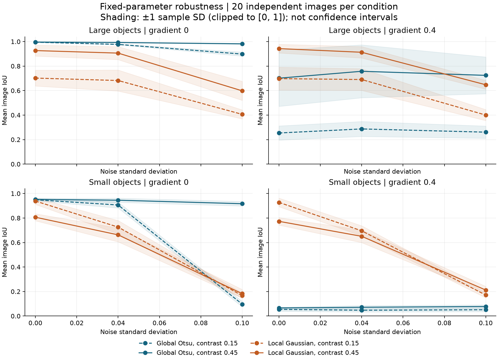
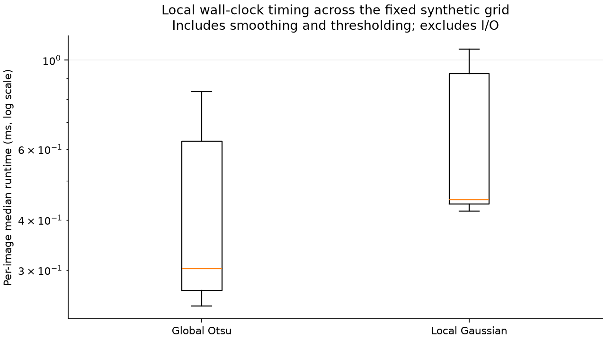
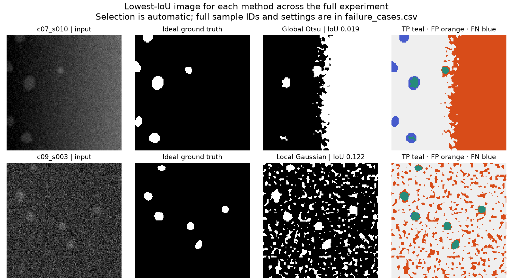

# Benchmarking Image Segmentation Methods: Accuracy, Robustness and Reproducibility on Synthetic Data

**Draft for personal scientific review and editing.** This article and its supporting software were prepared with AI assistance. The measurements below come from executed code and archived synthetic data, and the owner has explicitly authorized publication of this separate benchmark. Substantive author review and editing of the article and scientific interpretation are still pending. This draft must not be represented as personally written and verified by the owner before that review.

## Research question

When does a spatially adaptive threshold help, and what does it sacrifice? The experiment compares two fixed thresholding pipelines as image contrast, noise, illumination and shape scale change. It asks a bounded numerical question: how well do their binary masks recover the known geometric foreground in this particular synthetic generator?

Across 480 images, global Otsu achieved mean image IoU **0.581701** and local Gaussian thresholding achieved **0.642703**. That aggregate hides substantial reversals. In a low-contrast, noiseless condition with small shapes and an illumination gradient, the local method achieved 0.9276 ± 0.0351, versus 0.0542 ± 0.0155 for Otsu. In low-contrast, noiseless images with large shapes and uniform illumination, Otsu achieved 0.9953 ± 0.0025, versus 0.7021 ± 0.0646 for the local method. All ± quantities here are sample standard deviations over 20 images, not confidence intervals.

The useful conclusion is conditional. Illumination adaptation can help dramatically in this design, while a fixed local scale and offset can lose foreground or accept noise. The project demonstrates how to retain and explain those tradeoffs, with inspectable data behind each number.

## Why a synthetic benchmark?

An exact binary ground truth makes numerical checking straightforward. Every output pixel can be classified as a true positive, false positive, false negative or true negative. No annotation judgment is needed to decide whether a mathematical ellipse includes a pixel.

That convenience has a cost: these shapes are not a validated model of biological images. They omit texture, variable staining, correlated sensor noise, three-dimensional optics and annotation disagreement. The project is a research-software demonstration. It does not establish clinical validity, validate biological measurements, or reproduce results from any published paper. It uses fresh code and public numerical libraries, independently of unpublished research software.

## The two pipelines

Both pipelines receive the identical float32 image. Both validate its range and dimensionality, convert it to float64, and apply Gaussian smoothing with sigma 1 pixel and reflected boundaries. The preprocessing is included in timing. No method receives the ground-truth mask or the condition label, and there is no morphological cleanup, per-image parameter adjustment, or resizing.

**Global Otsu** uses a 256-bin intensity histogram to select one threshold for the image. Pixels strictly above it are foreground. Its statistical criterion separates two intensity classes, which need not coincide with foreground and background when illumination varies. The implementation is `skimage.filters.threshold_otsu` from scikit-image 0.25.2. The pinned implementation uses float32 histogram weights. The audit found that a float64 weight-product alternative changes three pixels in one of the 480 images; the relative objective difference is about 1.46e-8. Reported scores consistently use the pinned implementation. See the [Otsu API](https://scikit-image.org/docs/0.25.x/api/skimage.filters.html#skimage.filters.threshold_otsu) and [original method](https://doi.org/10.1109/TSMC.1979.4310076).

**Local Gaussian thresholding** uses `skimage.filters.threshold_local` with Gaussian weighting, block size 41, offset −0.025, and reflected boundaries. The default local Gaussian scale is (41−1)/6 pixels. Here the block-size argument determines sigma; SciPy truncates the kernel at four sigma, giving a 55-pixel support on each axis, rather than a literal 41-pixel window. The initial sigma-1 smoothing has 9-pixel support. See the [Gaussian filter definition](https://docs.scipy.org/doc/scipy/reference/generated/scipy.ndimage.gaussian_filter.html). The threshold is the weighted local mean minus the offset; thus the negative offset requires intensity to exceed the local mean by 0.025. See the [local threshold API](https://scikit-image.org/docs/0.25.x/api/skimage.filters.html#skimage.filters.threshold_local).

The local scale spans several small-object radii, and its offset suppresses weak background fluctuations. These are fixed engineering choices, recorded before inspecting evaluation scores. They are not claimed to be optimal. This is a comparison of two configured pipelines, not of the best achievable version of either method. A fair tuning study would use separate development seeds, equal search budgets, and a held-out evaluation set.

## Dataset generation and ground truth

Each 128 × 128 scene contains six randomly placed, rotated ellipses. Major radii are uniformly distributed in the condition's range; minor/major radius ratios are uniform on [0.65, 1], and orientations are uniform on [0, π). Centers are sampled within the image. Shapes may overlap or touch the image boundary, and no inconvenient sample is rejected. Ground truth is the binary union of the geometric shapes before optical blur.

Let M be that mask, x the horizontal pixel coordinate, n the image width, c contrast, g the full horizontal gradient amplitude, and ε independent Gaussian noise with standard deviation σ. The pre-clipping intensity is:

```text
I_raw(x, y) = 0.2 + c × GaussianBlur(M, sigma=1)
                  + g × (x / (n − 1) − 0.5) + ε(x, y)
I = float32(clip(I_raw, 0, 1))
```

The evaluator compares predictions with M, not with a thresholded blurred image. Optical blur in generation and common smoothing in segmentation are distinct operations. Their effect on boundaries is part of the experiment.

| Factor | Levels |
|---|---|
| Foreground contrast c | 0.15, 0.45 |
| Gaussian noise σ | 0, 0.04, 0.10 |
| Horizontal peak-to-peak gradient g | 0, 0.4 |
| Major-radius range | small: 4–8 pixels; large: 12–18 pixels |
| Independent images per combination | 20 |

This gives 2 × 3 × 2 × 2 = 24 conditions, 480 images, and 960 method-image evaluations. Changing radius also changes occupied area and overlap: this factor is a scene characteristic, not a clean causal isolation of radius. Across the executed dataset, foreground occupied 2.0264%–24.7192% of pixels. Clipping ranged from 0.0000% to 10.5835%, so the realized noise distribution near intensity limits is not an unbounded Gaussian.

The master seed is 20261031. Each sample uses an explicit uint64 seed derived by NumPy `SeedSequence([master_seed, condition_index, sample_index])`, followed by the PCG64 generator. The manifest records every seed. Configuration order is part of the protocol; radius labels are sorted, with large before small. Scenes are independent across condition/sample identifiers and paired across methods. Different conditions do not reuse identical shapes, so a change across condition means includes sampling variability as well as the controlled factor change.

## Metrics and experimental unit

Foreground pixels are positive. With TP, FP, FN and TN denoting confusion counts:

```text
IoU       = TP / (TP + FP + FN)
Precision = TP / (TP + FP)
Recall    = TP / (TP + FN)
F1        = 2 TP / (2 TP + FP + FN)
```

For binary masks, F1 is the Dice overlap coefficient. The independent verifier also checks `F1 = 2 IoU / (1 + IoU)`. When both masks are empty, all four metrics are defined as 1. If truth is nonempty but the prediction is empty, precision is 0. When truth is empty, recall is defined as 1; an erroneous positive prediction still gives IoU and F1 of 0. These conventions are explicitly tested, though the benchmark scenes contain foreground.

Every pixel is evaluated, including borders. Metrics are calculated for each image and then averaged: these are **macro averages of ratios**, not ratios calculated from pooled pixel counts. The image is the independent experimental unit. Within each condition, sample SD uses denominator n−1.

For paired comparisons, compute each image's local-minus-Otsu IoU difference. Resample the 20 image pairs 5,000 times and report the 2.5th and 97.5th percentiles of the bootstrap mean. The bootstrap uses its own deterministic seed namespace. These are exploratory pointwise intervals with no adjustment for inspecting 24 conditions. Pixels and repeated timings are not treated as independent replicates.

## Results from the executed run

The final candidate reference run, following dependency-security remediation, used CPython 3.12.14 on Windows 11 (AMD64) with 32 logical CPUs. The [metadata file](../results/reference/metadata.json) records package versions, machine descriptors, thread settings, UTC times, and code/configuration hashes. The implementation used NumPy 2.5.4, SciPy 1.18.1, scikit-image 0.25.2 and Matplotlib 3.11.2.

| Pipeline | Mean image IoU | Mean image F1 | Images with IoU < 0.5 | Median image runtime |
|---|---:|---:|---:|---:|
| Global Otsu | 0.581701 | 0.639368 | 212 / 480 | 0.30215 ms |
| Local Gaussian | 0.642703 | 0.747756 | 124 / 480 | 0.44900 ms |

The overall grid is deliberately balanced; those weights are a design choice rather than an estimate of real-world scene frequency. The IoU < 0.5 count is a descriptive diagnostic, not a validated quality threshold. All images remain in all aggregates.



*Figure 1. Image-level mean IoU as noise increases, separated by radius range and illumination. Shading is ±1 sample SD, clipped to [0, 1]; it is not a confidence band. Lines connect different independently generated condition samples.*

### Full condition table

The values below are generated from `summary.csv`. Each entry is mean ± sample SD over 20 images. The condition identifiers are the join keys into `raw.csv` and `manifest.csv`.

| Condition | Size | Contrast | Noise | Gradient | Otsu IoU | Local IoU |
|---|---|---:|---:|---:|---:|---:|
| c00 | large | 0.15 | 0 | 0 | 0.9953 ± 0.0025 | 0.7021 ± 0.0646 |
| c01 | small | 0.15 | 0 | 0 | 0.9488 ± 0.0087 | 0.9385 ± 0.0273 |
| c02 | large | 0.15 | 0 | 0.4 | 0.2539 ± 0.0578 | 0.6978 ± 0.0934 |
| c03 | small | 0.15 | 0 | 0.4 | 0.0542 ± 0.0155 | 0.9276 ± 0.0351 |
| c04 | large | 0.15 | 0.04 | 0 | 0.9772 ± 0.0036 | 0.6823 ± 0.0859 |
| c05 | small | 0.15 | 0.04 | 0 | 0.9064 ± 0.0249 | 0.7258 ± 0.0540 |
| c06 | large | 0.15 | 0.04 | 0.4 | 0.2871 ± 0.0610 | 0.6903 ± 0.0888 |
| c07 | small | 0.15 | 0.04 | 0.4 | 0.0475 ± 0.0145 | 0.6956 ± 0.0414 |
| c08 | large | 0.15 | 0.1 | 0 | 0.8982 ± 0.0165 | 0.4060 ± 0.0366 |
| c09 | small | 0.15 | 0.1 | 0 | 0.0968 ± 0.0221 | 0.1662 ± 0.0216 |
| c10 | large | 0.15 | 0.1 | 0.4 | 0.2608 ± 0.0501 | 0.4003 ± 0.0448 |
| c11 | small | 0.15 | 0.1 | 0.4 | 0.0513 ± 0.0158 | 0.1711 ± 0.0224 |
| c12 | large | 0.45 | 0 | 0 | 0.9962 ± 0.0015 | 0.9267 ± 0.0448 |
| c13 | small | 0.45 | 0 | 0 | 0.9523 ± 0.0082 | 0.8065 ± 0.0287 |
| c14 | large | 0.45 | 0 | 0.4 | 0.7013 ± 0.2299 | 0.9428 ± 0.0355 |
| c15 | small | 0.45 | 0 | 0.4 | 0.0660 ± 0.0069 | 0.7731 ± 0.0306 |
| c16 | large | 0.45 | 0.04 | 0 | 0.9928 ± 0.0026 | 0.9060 ± 0.0530 |
| c17 | small | 0.45 | 0.04 | 0 | 0.9454 ± 0.0170 | 0.6626 ± 0.0565 |
| c18 | large | 0.45 | 0.04 | 0.4 | 0.7577 ± 0.2158 | 0.9129 ± 0.0467 |
| c19 | small | 0.45 | 0.04 | 0.4 | 0.0715 ± 0.0140 | 0.6506 ± 0.0511 |
| c20 | large | 0.45 | 0.1 | 0 | 0.9817 ± 0.0033 | 0.5980 ± 0.0776 |
| c21 | small | 0.45 | 0.1 | 0 | 0.9168 ± 0.0186 | 0.1823 ± 0.0344 |
| c22 | large | 0.45 | 0.1 | 0.4 | 0.7244 ± 0.1501 | 0.6476 ± 0.0357 |
| c23 | small | 0.45 | 0.1 | 0.4 | 0.0777 ± 0.0134 | 0.2119 ± 0.0299 |


### Reversals matter more than a leaderboard

In **c03**, small shapes under a 0.4 illumination gradient at contrast 0.15 and zero noise, the local-minus-Otsu paired IoU difference was **0.873493**, with a pointwise bootstrap interval of [0.860757, 0.884606]. Local thresholding had higher IoU on all 20 images. Otsu's mean precision was 0.0547, consistent with extensive false-positive foreground under uneven illumination.

In **c00**, large shapes with the same low contrast, zero noise and uniform illumination, the direction reversed. The local method's mean precision was 1.0000, but its mean recall was only 0.7021. This is consistent with a local threshold losing the interiors of large, nearly uniform foreground regions: the local mean rises toward the object intensity, while the fixed positive margin remains. That mechanism is an interpretation of the masks and metric pattern, not a separately isolated causal experiment.

The noisy, high-contrast small-object condition **c21** also contradicts a blanket recommendation for adaptation: Otsu reached 0.9168 ± 0.0186, versus 0.1823 ± 0.0344 for the local method. The local method's mean recall remained 0.9991, while precision fell to 0.1824. High recall alone would hide severe false positives.

| Condition | Mean local − Otsu IoU | Pointwise 95% bootstrap interval | Local / Otsu wins |
|---|---:|---:|---:|
| c00 | -0.2932 | [-0.3202, -0.2670] | 0 / 20 |
| c01 | -0.0103 | [-0.0216, 0.0005] | 10 / 10 |
| c03 | 0.8735 | [0.8608, 0.8846] | 20 / 0 |
| c21 | -0.7344 | [-0.7451, -0.7231] | 0 / 20 |


The c01 interval straddles zero. That is not proof of equivalence; this small experiment does not resolve a clear mean advantage there. Across the full table, higher contrast does not automatically improve the fixed local method: an absolute offset and blurred boundaries need not behave monotonically with contrast, and the sampled geometry also differs across conditions. Parameters were not changed to conceal these outcomes.

## Runtime: useful context, bounded claims

Each image/method received one untimed warm-up, followed by five measurements with interleaved randomized method order. Timing used `perf_counter_ns`. The per-image statistic is the median of its five elapsed times; the overall statistic is the median across image medians. All 4,800 observations are in `timings.csv`.

Timing includes input validation, conversion, common smoothing, threshold computation and Boolean output. It excludes imports, synthetic generation, disk I/O, scoring, plotting and the post-timing equality check. Otsu's observed median was 0.30215 ms and the local method's was 0.44900 ms. These sub-millisecond measurements are local wall-clock observations, not throughput or latency guarantees.



*Figure 2. Distribution of the 480 per-image median runtimes for each method, on a logarithmic axis. Boxes show the interquartile range and median; whiskers follow Matplotlib's 1.5-IQR rule. Machine load, frequency scaling and scheduling were not controlled. Thread limits were recorded, but process affinity was not fixed. This plot shows the final candidate run. Two further local executions confirmed accuracy, but all runs were on the same host and date; this is not a longitudinal performance study.*

## Failure cases retained in the dataset



*Figure 3. The lowest-IoU image for each method, selected automatically over all 480 images per method. Teal marks true positives, orange false positives and blue false negatives. These two images illustrate extremes and are not presented as typical samples.*

Otsu's lowest-IoU case, **c07_s010**, had TP=163, FP=7842 and FN=380. Therefore its IoU is `163 / (163 + 7842 + 380) = 0.019439475`. The mask follows a broad bright part of the illumination field and misses some dim-side shapes.

The local method's lowest-IoU case, **c09_s003**, had TP=367, FP=2622 and FN=9, giving IoU `367 / (367 + 2622 + 9) = 0.122414943`. Recall was 0.9761, but precision was only 0.1228. The saved prediction shows many noise-related positive regions. No postprocessing was added after seeing this failure.

## Reproduce every number

From a fresh checkout, use CPython 3.12 and the pinned environment. On Linux/macOS:

```bash
python3.12 -m venv .venv
source .venv/bin/activate
python -m pip install --upgrade pip==26.2.2
python -m pip install -r requirements.txt
python -m pip check
export OMP_NUM_THREADS=1 OPENBLAS_NUM_THREADS=1 MKL_NUM_THREADS=1
python -m pytest -q
python -m segbench.run --config configs/default.json --output runs/reproduce
python -m segbench.report runs/reproduce
python -m segbench.verify runs/reproduce --regenerate
```

Windows PowerShell commands, with Python 3.12 available as `python`:

```powershell
python -m venv .venv
& .\.venv\Scripts\python.exe -m pip install --upgrade pip==26.2.2
& .\.venv\Scripts\python.exe -m pip install -r requirements.txt
& .\.venv\Scripts\python.exe -m pip check
$env:OMP_NUM_THREADS = '1'
$env:OPENBLAS_NUM_THREADS = '1'
$env:MKL_NUM_THREADS = '1'
& .\.venv\Scripts\python.exe -m pytest -q
& .\.venv\Scripts\python.exe -m segbench.run --config configs/default.json --output runs/reproduce
& .\.venv\Scripts\python.exe -m segbench.report runs/reproduce
& .\.venv\Scripts\python.exe -m segbench.verify runs/reproduce --regenerate
```

Use a new output path if `runs/reproduce` already exists. To audit the supplied reference artifacts instead, run `python -m segbench.verify results/reference --regenerate`. The report command regenerates all charts and numerical tables; prose remains subject to scientific review. No image downloads are required.

For the aggregate headline, inspect `overall.csv` and the corresponding 480 rows per method in `raw.csv`. For c03, select its 20 rows per method and average their IoU values; `paired.csv` contains the paired differences and interval. For the explicit failure-case arithmetic, load the named NPZ archive with `allow_pickle=False`, count the prediction/truth combinations, and apply the formula above. The [data dictionary](DATA_DICTIONARY.md) describes every file and the canonical array hashes.

The final local test run passed **52 tests in 11.83 seconds**. Independent arithmetic verification checked **960 rows and 4,800 timing observations**, and regeneration exactly matched **all 480 images and both predictions** in the recorded environment. The routine verifier uses a separate four-bin confusion calculation and checks the F1/IoU identity. A further [audit tool](../tools/independent_science_audit.py) independently implements the ellipse geometry, Gaussian kernels, configured threshold arithmetic, confusion counts, sample SD and bootstrap percentiles without importing the benchmark, SciPy or scikit-image. It matched all archived images and predictions; all 48 bootstrap endpoints agreed within 1.12e-16. NumPy still supplies array operations and the specified random stream, and the same AI reviewer wrote both implementations; this is not independent human peer review. The [validation record](VALIDATION.md) records the original and fresh-environment runs, dependency-download issues, and the security fixes. The prior setup also included a test launch before pytest installation finished; no tests ran in that launch. No complete pytest run failed, and no method failed with an exception in the full benchmark.

Accuracy and timing have different reproducibility expectations. Exact array equality was observed locally, but different hardware, operating systems or numerical-library builds may introduce floating point differences. Runtime will vary. The public [GitHub Actions workflow](https://github.com/dimitrispasias57-eng/microstructai-reproducible-benchmark/actions/workflows/tests.yml) reports Linux and Windows test outcomes. The archived complete 480-image reference and the independent numerical audit were executed on Windows; a CI test pass alone does not establish a full cross-platform replication.

## What these measurements establish — and what they leave open

The results establish how these two fixed implementations performed on a documented synthetic distribution, with exact geometric labels and retained artifacts. They support conditional statements about measured tradeoffs within that distribution, and demonstrate a reproducible numerical workflow.

They do not establish biological truth, cell-count accuracy, instance separation, topology preservation, clinical performance or generalization to a different microscope. Pixel overlap can look favorable while merging objects or changing important boundaries. The six shapes are semantic foreground; overlaps are not individually labeled. Future work should add task-appropriate object, boundary and topology metrics where those are actual goals.

There is no held-out parameter optimization, no real-data external validation, no external human replication, and no multi-machine timing campaign. The chosen balanced grid and fixed local offset shape the aggregate result. Larger scenes alter foreground occupancy, and clipping changes noise near intensity bounds. Twenty images per condition describe this generator but do not justify a broad population claim. Any new method or parameter selection should be evaluated using a documented development/evaluation separation.

Finally, this experiment has no live API requests. Translating the same research discipline to an API comparison would require matched query workloads, provider-specific success definitions, externally measured latency distributions, concurrency and retry policy, rate-limit handling, cost accounting, response correctness, and measurements over time. Those are plausible follow-up experiments, not skills proven by these image-segmentation scores.
